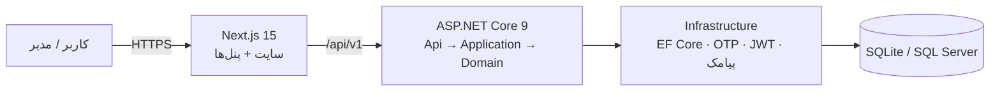

# CarShop — پلتفرم نمایشگاه خودرو (پروژه‌ی وایب کدینگ)

> 🇩🇪 نسخه‌ی آلمانی: [README.md](README.md)

### 🚀 نسخه‌ی نمایشی آنلاین: **https://carshop-udch.onrender.com/**

> سرور رایگان Render است؛ اولین باز شدن ممکن است تا حدود یک دقیقه طول بکشد. همه‌ی خودروها، قیمت‌ها و اطلاعات نمونه هستند.
> ورود به پنل مدیریت: در صفحه‌ی ورود، کادر «ورود سریع به پنل مدیریت» + رمز نمایشی.

## 💡 درباره‌ی این پروژه

این پروژه **ایده‌ای است که از روی کنجکاوی پیاده‌سازی کردم** — **دومین پروژه‌ی من با وایب کدینگ و Claude**.
می‌خواستم ببینم با توسعه‌ی کمک‌گرفته از هوش مصنوعی تا کجا می‌شود پیش رفت: یک پلتفرم کامل و واقعی برای یک نمایشگاه خودروی فرضی، با موجودی، رزرو آنلاین، خدمات و قیمت‌ها، و پنل مدیریت، کارمند و کاربر.
ایده‌ها، نیازها، تصمیم‌ها و تست‌ها با من بود و Claude در نوشتن کد، تست و مستندات کمک کرد. تجربه‌ای **جالب و جذاب** بود و چیزهای زیادی درباره‌ی Clean Architecture، امنیت، همزمانی و فرانت‌اند مدرن یاد گرفتم.

بک‌اند سه‌لایه با **ASP.NET Core 9** و فرانت **Next.js 15** (پوشه‌ی `web/`) که UI آن از کامپوننت‌های 21st.dev ساخته شده است.

## 📸 تصاویر

| صفحه‌ی اول | موجودی با فیلتر |
|---|---|
|  |  |
| **صفحه‌ی خودرو** | **خدمات و قیمت‌ها** |
|  |  |
| **داشبورد مدیریت** | **ویرایش قیمت خدمات** |
|  |  |

<p>
  
  
  
</p>

## 🏗️ معماری



## ساختار

```
MoravejiMotors.sln
├── src/
│   ├── Moraveji.Domain          ← قوانین کسب‌وکار (خودرو، رزرو، سفارش، سرنخ) — بدون وابستگی
│   ├── Moraveji.Application     ← سرویس‌ها، DTOها، اعتبارسنجی (FluentValidation)، کش
│   ├── Moraveji.Infrastructure  ← EF Core، Identity، OTP، JWT، پیامک، Seed، Jobها
│   └── Moraveji.Api             ← کنترلرها، امنیت، Rate Limit، Swagger
├── tests/
│   ├── Moraveji.UnitTests        ← ۳۷ تست دامنه
│   └── Moraveji.IntegrationTests ← ۲۷ تست API روی دیتابیس واقعی (رزرو همزمان، حمله‌ی موازی به OTP، ...)
├── docs/                         ← کامپوننت‌های 21st و تصاویر
└── docker-compose.yml
```

## اجرا با Visual Studio (ساده‌ترین راه) ✅

۱. `MoravejiMotors.sln` را در Visual Studio باز کنید.
۲. بالای صفحه پروفایل **«CarShop (سایت + API)»** را انتخاب کنید و **F5** بزنید.

همین. Visual Studio خودش:
- API را روی `http://localhost:5080` اجرا می‌کند،
- اگر بار اول است `npm install` را برای سایت انجام می‌دهد (چند دقیقه)،
- سایت Next.js را روی `http://localhost:3000` بالا می‌آورد و مرورگر را روی سایت باز می‌کند،
- با **Stop** هر دو را می‌بندد.

پیش‌نیاز فقط **.NET 9 SDK** و **Node.js LTS** است (یک بار `setup.bat` هر دو را نصب می‌کند).
پروفایل «فقط API (Swagger)» برای تست مستقیم API است.

## ورود به پنل‌ها

| پنل | آدرس | ورود |
|---|---|---|
| **پنل مدیریت (ادمین)** | http://localhost:3000/admin | شماره `09120000001` ← کد ۶ رقمی در پنجره‌ی خروجی/کنسول API با عبارت `DEV OTP for 09120000001: ......` چاپ می‌شود |
| **پنل کارمند (کارشناس فروش)** | همان `/admin` | شماره‌های `09120000002` و `09120000003` (دسترسی محدود: بدون تغییر قیمت و کاربران) |
| **پنل کاربر** | http://localhost:3000/account | هر شماره‌ی موبایل دیگری؛ اولین ورود = ثبت‌نام |

در حالت توسعه پیامک واقعی ارسال نمی‌شود؛ کد ورود در کنسول API (در Visual Studio پنجره‌ی Output یا کنسول برنامه) چاپ می‌شود.

**امکانات پنل مدیریت:** داشبورد آمار · خودروها (افزودن، ویرایش قیمت، انتشار/پنهان/فروخته‌شد، حذف) · خدمات و قیمت‌ها (افزودن، ویرایش، تخفیف، نمایش/عدم نمایش، حذف — بلافاصله در `/services` دیده می‌شود) · درخواست‌ها (تغییر وضعیت، تماس و واتس‌اپ) · کاربران و کارمندان (افزودن کارمند با شماره، تغییر نقش).

**امکانات پنل کاربر:** رزروهای من (با امکان لغو)، درخواست‌های من، ویرایش پروفایل.

## اجرا روی ویندوز (دستی، بدون Visual Studio)

۱. **.NET 9 SDK** را نصب کنید: https://dotnet.microsoft.com/download/dotnet/9.0

۲. در پوشه‌ی پروژه:

```powershell
cd C:\xampp\htdocs\galeri
dotnet test                       # باید ۶۴ تست سبز شود
dotnet run --project src\Moraveji.Api --urls http://localhost:5080
```

۳. Swagger: http://localhost:5080/swagger

در حالت Development:
- دیتابیس **SQLite** (فایل `moraveji-dev.db`) خودکار ساخته و با ۲۰ خودروی نمونه پر می‌شود — نیازی به نصب SQL Server نیست.
- **کد OTP پیامک نمی‌شود**؛ در کنسول با عبارت `DEV OTP for ...` چاپ می‌شود.
- شماره‌ی ادمین نمونه: `09120000001` — کارمندها: `09120000002`، `09120000003`.

## اجرای سایت (فرانت — Next.js + کامپوننت‌های 21st.dev)

پیش‌نیاز: **Node.js 20 یا بالاتر** (https://nodejs.org).

```powershell
# پنجره‌ی اول: API
cd C:\xampp\htdocs\galeri
dotnet run --project src\Moraveji.Api --urls http://localhost:5080

# پنجره‌ی دوم: سایت
cd C:\xampp\htdocs\galeri\web
copy .env.example .env.local
npm install
npm run dev
```

سایت: http://localhost:3000 — حتماً با `localhost` باز کنید (نه 127.0.0.1) تا کوکی ورود درست کار کند.

**برای اجرای آفلاین** (یا اگر Unsplash/Pexels کند یا فیلتر باشد):

```powershell
cd C:\xampp\htdocs\galeri\web
npm run fetch-media
# سپس در web\.env.local بگذارید:  NEXT_PUBLIC_LOCAL_MEDIA=1
npm run build
npm run start
```

صفحه‌ها: `/` (هیروی ویدیو-اسکرول، خرید از راه دور، موجودی، خدمات، همکاری‌ها، نظرات) · `/inventory` (فیلتر و جستجو) · `/cars/{slug}` (گالری، مشخصات، رزرو با بیعانه) · `/login` (ورود با کد پیامکی) · `/contact?type=SellMyCar|VisitRequest|Sourcing|...`

جدول کامل کامپوننت‌های 21st: `docs/21st-components.md` — منابع عکس و ویدیو: `CREDITS.md`.

## ورود (OTP)

```
POST /api/v1/auth/otp      {"phone":"09171234567"}
POST /api/v1/auth/verify   {"phone":"09171234567","code":"123456","fullName":"..."}
POST /api/v1/auth/refresh  (کوکی HttpOnly)
POST /api/v1/auth/logout
```

- Access Token: ۱۵ دقیقه. Refresh Token: کوکی `HttpOnly; Secure; SameSite=Strict`، با **چرخش** در هر استفاده؛ استفاده‌ی دوباره از توکن قدیمی = ابطال کل نشست (تشخیص سرقت).
- کد OTP فقط به‌صورت HMAC ذخیره می‌شود، ۲ دقیقه اعتبار، حداکثر ۵ تلاش، ۳ ارسال در ۱۰ دقیقه، ۶۰ ثانیه فاصله بین ارسال‌ها.

## API اصلی

| متد | مسیر | دسترسی |
|---|---|---|
| GET | `/api/v1/cars?listingType=&condition=&brand=&yearFrom=&priceToRial=&tags=&sort=&page=` | عمومی |
| GET | `/api/v1/cars/{slug}` | عمومی |
| POST | `/api/v1/cars/{id}/reservations` | کاربر واردشده — `409` اگر کسی زودتر رزرو کرده باشد |
| POST | `/api/v1/leads` | عمومی (درخواست قیمت، بازدید، خرید از راه دور، ...) |
| GET / PATCH | `/api/v1/leads` ، `/api/v1/leads/{id}/status` | کارمند (فقط سرنخ‌های خودش + بدون مسئول) / ادمین (همه) |
| POST | `/api/v1/admin/cars` | کارمند یا ادمین |
| PUT | `/api/v1/admin/cars/{id}` | فقط ادمین (تغییر قیمت) |
| GET | `/api/v1/services` | عمومی (لیست قیمت خدمات) |
| GET / POST / PUT / DELETE | `/api/v1/admin/services` | خواندن: کارمند و ادمین — تغییر: فقط ادمین |
| GET / POST | `/api/v1/admin/cars` ، `/api/v1/admin/cars/{id}` ، `/{id}/status` | کارمند/ادمین (تغییر وضعیت و حذف: فقط ادمین) |
| GET | `/api/v1/admin/stats` | کارمند و ادمین |
| GET / POST / PUT | `/api/v1/admin/users` ، `/{id}/role` | فقط ادمین |
| GET / PUT | `/api/v1/me` ، `/me/reservations` ، `/me/reservations/{id}/cancel` ، `/me/leads` | کاربر واردشده (فقط داده‌های خودش) |
| GET | `/health/live` ، `/health/ready` | پایش |

## تضمین‌های امنیت پول و فروش

- **یک ماشین هرگز دو بار رزرو/فروخته نمی‌شود:** توکن همزمانی (`Version`) روی هر ردیف + **ایندکس یکتای فیلترشده** `UX_Reservations_OneActivePerCar` در خود دیتابیس. تست خودکار: ۶ کاربر همزمان → دقیقاً ۱ موفق، بقیه `409`.
- **هر کاربر هم‌زمان فقط یک رزرو فعال** (ایندکس یکتای `UX_Reservations_OneActivePerCustomer`) + Rate Limit روی رزرو — یک حساب نمی‌تواند کل نمایشگاه را قفل کند.
- **ویرایش خودروی رزروشده آن را دوباره «موجود» نمی‌کند**؛ فرم ویرایش قدیمی (Version قدیمی) به‌جای بازنویسی تغییرات دیگران، `409` می‌گیرد.
- شمارنده‌ی تلاش OTP و چرخش Refresh Token **اتمیک** هستند (درخواست‌های موازی نمی‌توانند محدودیت را دور بزنند).
- پشت پروکسی (Docker/Render/Nginx) IP واقعی کاربر با `ForwardedHeaders` خوانده می‌شود؛ کلید پیامک در لاگ ثبت نمی‌شود.
- پول همیشه `long` به **ریال** (در UI تومان نمایش داده می‌شود).
- مسیر سفارش یک **State Machine** است: رزرو → بیعانه → کارشناسی → قرارداد → تسویه → تعویض پلاک → تحویل؛ رد شدن از مرحله ممنوع.
- **Audit Log تغییرناپذیر** برای هر تغییر خودرو، رزرو و سرنخ (چه کسی، چه چیزی، کی).
- حذف نرم (Soft Delete)؛ داده‌ی کسب‌وکار هرگز پاک نمی‌شود.
- رزروهای منقضی‌شده هر دقیقه خودکار آزاد می‌شوند.
- شناسه‌ها `Guid` هستند (جلوگیری از حدس زدن شناسه‌ی دیگران).
- Rate Limit روی OTP، ورود و فرم‌ها؛ CORS فقط دامنه‌های مجاز؛ هدرهای امنیتی؛ خطاها به شکل ProblemDetails بدون Stack Trace.

## تنظیمات Production (فقط متغیر محیطی — هیچ رمزی در کد نیست)

فایل `.env.example` را ببینید. مهم‌ترین‌ها:

```
ASPNETCORE_ENVIRONMENT=Production
Database__Provider=SqlServer
ConnectionStrings__Default=Server=...;Database=MoravejiMotors;...
Jwt__SigningKey=<حداقل ۳۲ کاراکتر تصادفی>
Otp__HashKey=<حداقل ۳۲ کاراکتر تصادفی>
Sms__Provider=Kavenegar
Sms__ApiKey=<کلید کاوه‌نگار>
Sms__OtpTemplate=moraveji-otp
Seed__AdminPhone=09...
```

اگر `Jwt__SigningKey` یا `Otp__HashKey` در Production تنظیم نشده باشد، برنامه اجرا نمی‌شود (عمداً).

## ایده‌های بعدی

- [x] مرحله ۱: اسکلت سه‌لایه + ورود OTP + نقش‌ها
- [x] مرحله ۲: کاتالوگ خودرو + رزرو امن + سرنخ‌ها + Seed
- [x] مرحله ۳: فرانت Next.js فقط با کامپوننت‌های 21st.dev 
- [x] پنل مدیریت (داشبورد، خودروها، خدمات و قیمت‌ها، درخواست‌ها، کاربران) + پنل کاربر + صفحه‌ی خدمات
- [ ] مرحله ۴: خرید از راه دور، بیعانه و پرداخت (Parbad + Ledger + Outbox) — آپلود مستقیم عکس خودرو
- [ ] مراحل ۵ تا ۹: فروشگاه، قرارداد آنلاین، CRM کارمند، داشبورد ادمین، سخت‌سازی و دیپلوی
