# SiteKit – Website-Baukasten mit Einrichtungs-Assistent (Vibe-Coding-Projekt)

> 🇮🇷 Persische Version: [README.fa.md](README.fa.md)

<p>
  
  
  
  
  
  
  
  
</p>

## 💡 Über dieses Projekt

Eine **Idee, die ich aus Neugier umgesetzt habe**, wieder per **Vibe Coding mit Claude**.
Dieses Repository hieß zuerst **CarShop** – eine Website für genau eine Branche (Autohaus). Daraus ist SiteKit geworden: Ich wollte wissen,
ob man daraus eine **Vorlage** machen kann, bei der **alles im Admin-Panel änderbar** ist – Name, Logo, Farben, Texte, Menü, Felder, Inhalte –
und die beim ersten Öffnen einen **Assistenten** zeigt, der Schritt für Schritt erklärt, was man eintragen muss, bis die Seite fertig ist.

Dieselbe Installation kann ein Autohaus, ein Reisebüro, ein Shop oder ein Salon werden. Jede Installation ist unabhängig
(eigener Container, eigene Datenbank) und startet wahlweise **leer**, **mit Beispielinhalt** oder **mit einem exportierten Inhaltspaket**.

Ich habe Ideen, Anforderungen und Entscheidungen vorgegeben und alles getestet; Claude hat Code, Tests und Dokumentation mitgeschrieben.

## ✨ Funktionen

- **4 Branchen-Vorlagen:** Autohaus, Reisebüro, Shop, Dienstleistung/Salon – jeweils mit passenden Bezeichnungen („Tour“, „Fahrzeug“ …), Feldern (Ziel, Dauer, Hotel / Baujahr, km …), Kategorien und Menü.
- **Alles im Panel änderbar:** Name, Logo-Upload, Hauptfarbe, Hell/Dunkel, Ecken, Startseite (Hero mit Bild oder Video, Vorteile, Über uns, Zahlen, FAQ, CTA), Kontakt, Menü, aktive Seiten, Footer, SEO, eigene Felder und Filter.
- **Einrichtungs-Assistent in 8 Schritten:** Branche → Name & Logo → Aussehen (mit Live-Vorschau) → Kontakt → Startseite → erster Eintrag → Leistungen → Veröffentlichen. Jeder Schritt erklärt *warum* und gibt Tipps; ein schwebender **„Hilfe“-Knopf** zeigt überall die Checkliste.
- **Unveröffentlicht = „Demnächst“-Seite** für Besucher; Admin/Mitarbeiter sehen die echte Seite mit Vorschau-Leiste.
- **Inhaltspaket:** Alles (Einstellungen, Einträge, Leistungen) als JSON exportieren und in eine andere Installation importieren; „Von vorne beginnen“ leer oder mit Beispielinhalt.
- **Erster Admin per Setup-Key:** Eine frische Seite hat keinen Admin; wer den Key kennt, wird auf `/setup` Admin. Später dient der Key auch als Admin-Login, solange kein SMS-Panel angebunden ist.
- Allgemeine Einträge mit Bildern, Preisen (fest / „ab“ / auf Anfrage, Streichpreis), Status (Entwurf, veröffentlicht, versteckt, ausverkauft), Filter & Suche; Leistungen mit Preisliste; Anfragen (Leads); Benutzer & Rollen; Login per SMS-Code.

## 📸 Screenshots

| Assistent: Branche wählen | Einstellungen: Aussehen mit Vorschau |
|---|---|
| 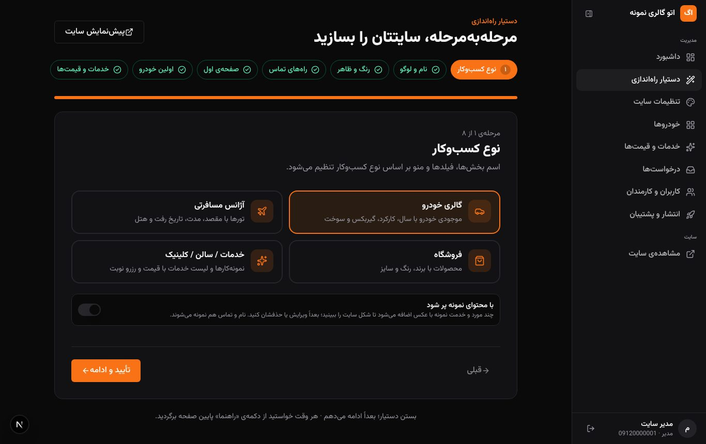 | 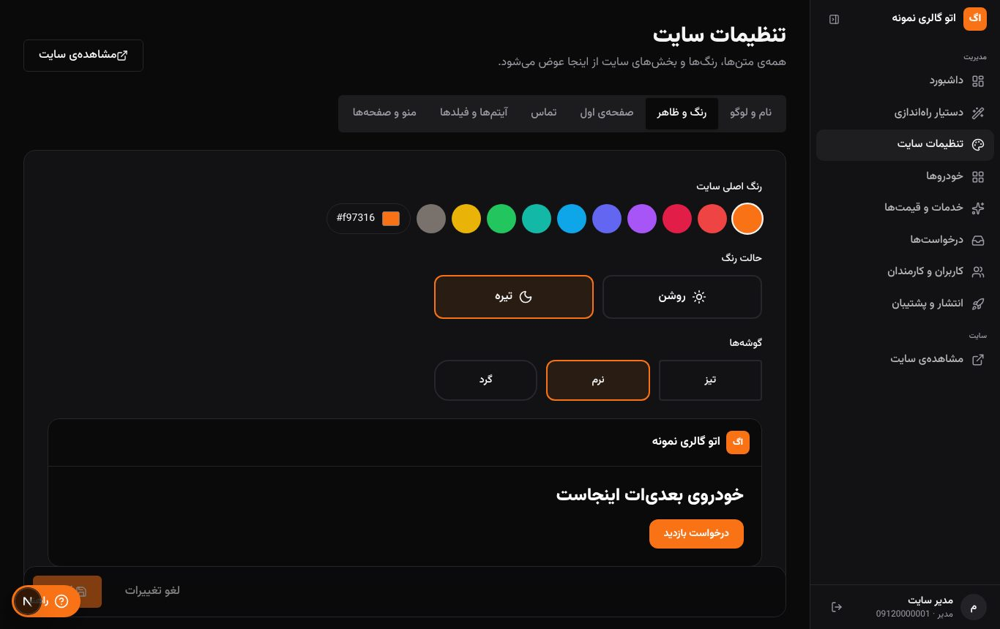 |
| **Eigene Felder & Kategorien** | **Veröffentlichen, Export/Import, Neustart** |
| 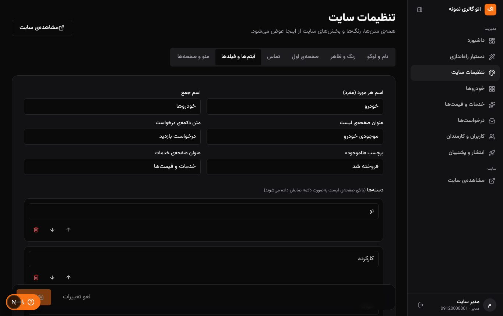 | 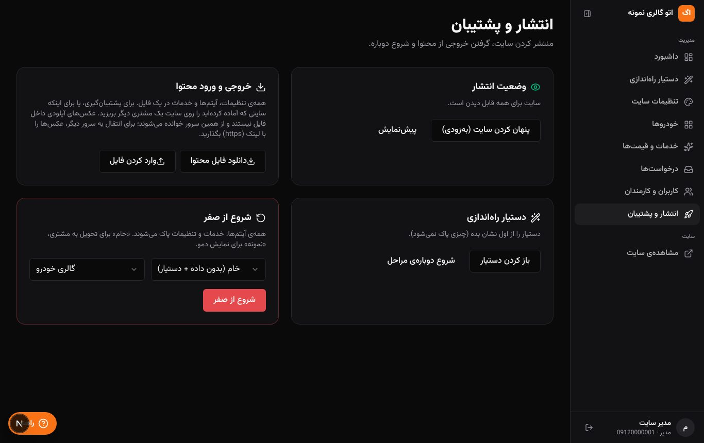 |
| **Beispiel: Vorlage „Autohaus“ mit Beispielinhalt** | **Ergebnis des Assistenten: „Reisebüro“** |
|  | 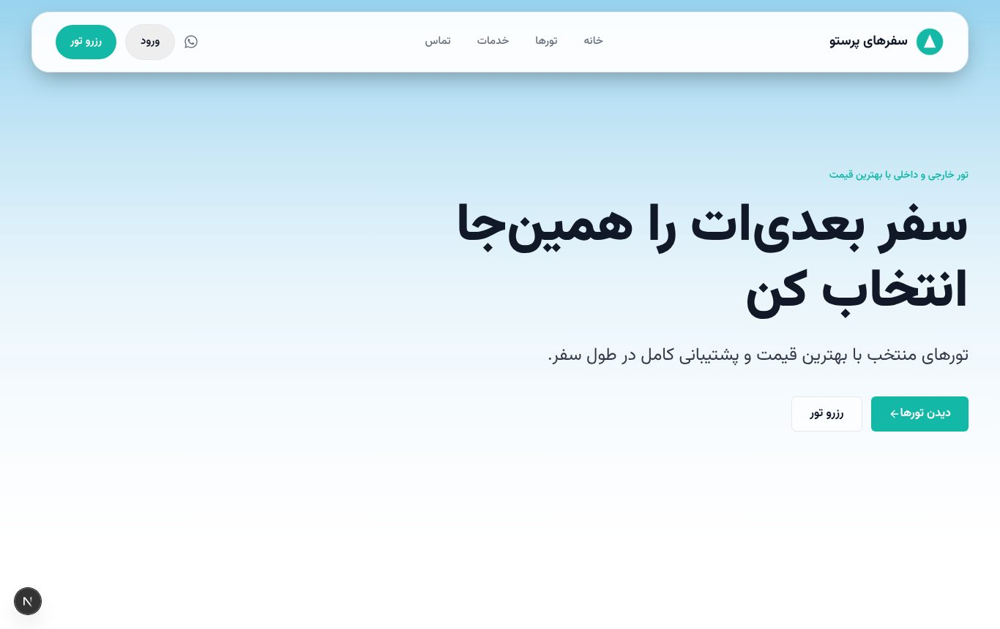 |
| **Liste mit Filtern aus eigenen Feldern** | **Admin-Dashboard mit Fortschritt** |
| 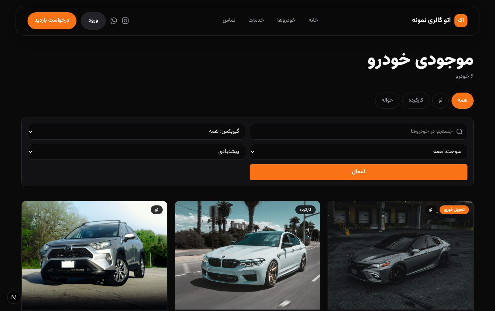 | 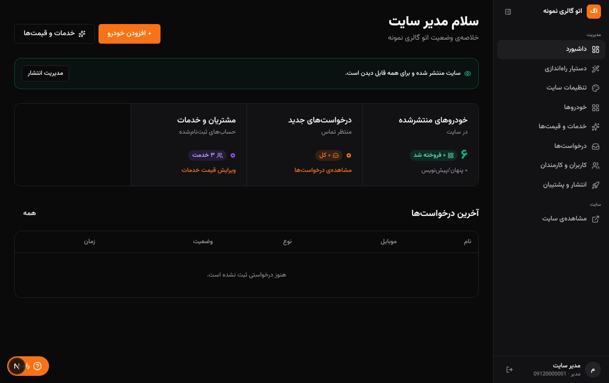 |

**Erster Start auf dem Handy – von leer bis online:**

<p>
  
  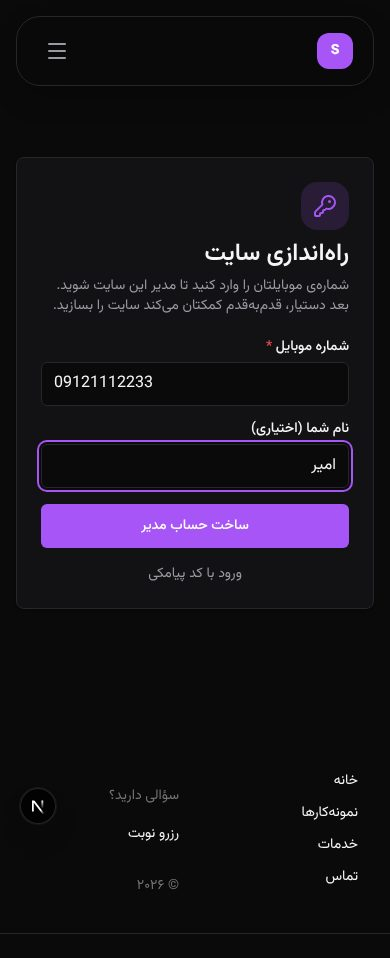
  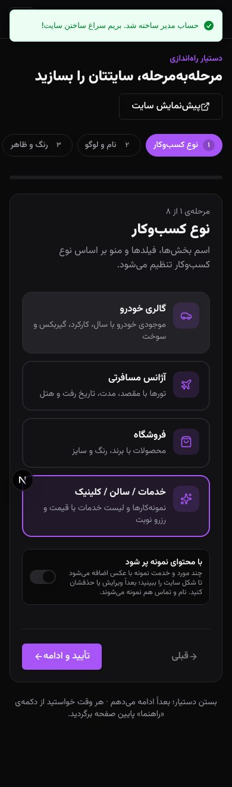
  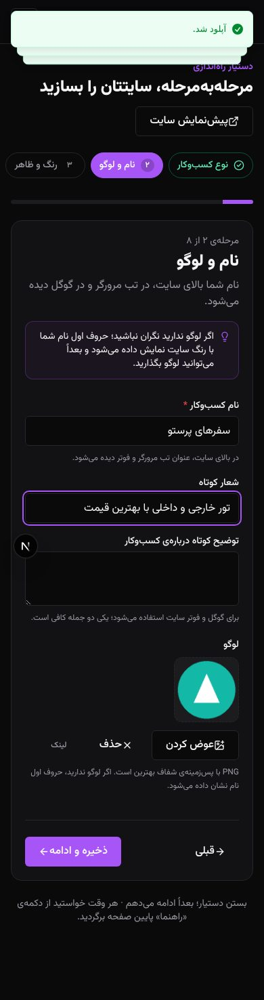
  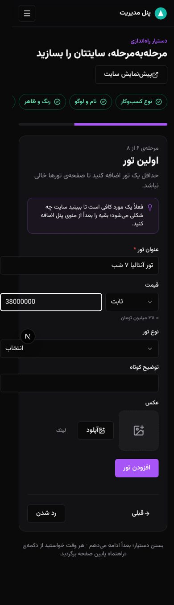
  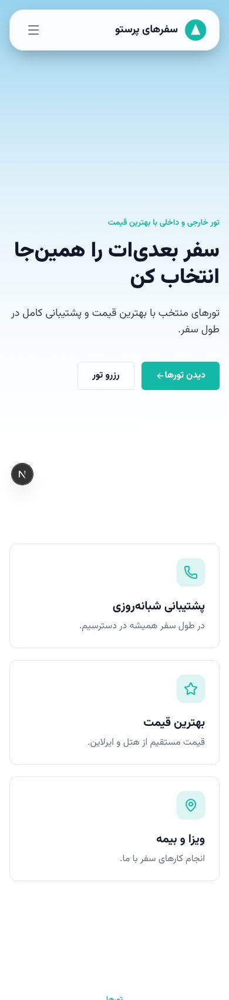
</p>

## 🧭 Ablauf beim ersten Start

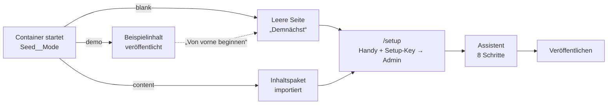

## 🏗️ Architektur

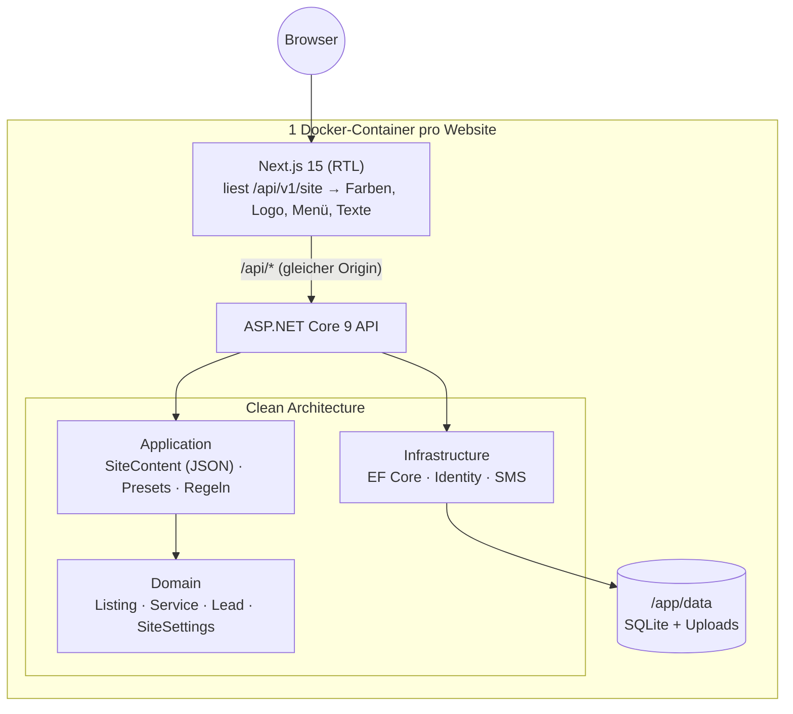

**Warum ein JSON-Dokument für die Einstellungen?** Alle Texte, Farben, Menüpunkte und Felddefinitionen liegen in *einer* Zeile (`SiteSettings.ContentJson`).
Neue Optionen brauchen keine Migration, und Export/Import ist trivial. Branchenspezifische Werte eines Eintrags (z. B. `destination`, `km`) liegen ebenfalls als JSON am Eintrag;
die Liste wird gecacht und im Speicher gefiltert – für den Katalog eines kleinen Unternehmens schnell genug und unabhängig vom Datenbank-Anbieter.

## 🧩 Technologien

| Bereich | Technologie | Wofür |
|---|---|---|
| Backend | **ASP.NET Core 9**, C# 13 | REST-API (`/api/v1`), ProblemDetails, FluentValidation |
| Architektur | **Clean Architecture** | Domain · Application · Infrastructure · Api |
| Daten | **EF Core 9**, SQLite (Standard), SQL Server optional | Optimistic Concurrency (Version-Token), Soft Delete, Audit-Log |
| Cache | **HybridCache** mit Tags | Seite, Einträge, Leistungen; Invalidierung bei jeder Änderung |
| Auth | ASP.NET Identity, **JWT** + HttpOnly-Refresh-Cookie mit Rotation | SMS-Code (OTP, als HMAC gespeichert), Setup-Key für den ersten Admin |
| Uploads | eigene Ablage in `/app/data/uploads` | Prüfung per Magic Bytes (JPG/PNG/WEBP/GIF/MP4), kein SVG/HTML, zufällige Namen |
| Frontend | **Next.js 15** (App Router), **React 19**, TypeScript, **Tailwind v4** | Theme per CSS-Variablen aus den Einstellungen, Vazirmatn-Schrift, RTL |
| UI | Komponenten von **21st.dev** (Navbar, Footer, Sidebar, CTA, Pricing Card …) + eigene Formular-Bausteine | siehe [docs/21st-components.md](docs/21st-components.md) |
| Tests | **xUnit**, WebApplicationFactory, **Playwright** | 64 Tests (Unit + Integration), E2E des Assistenten |
| Deployment | **Docker** (ein Container: API + Website), docker-compose | eine Instanz pro Website mit eigenem Volume |

## 🚀 Starten

### Mit Visual Studio
`SiteKit.sln` öffnen → Profil **„SiteKit (سایت + API)“** → **F5**. Die API startet, `npm run dev` wird automatisch gestartet, der Browser öffnet sich.
In der Entwicklung startet die Seite mit Beispielinhalt (Vorlage „Autohaus“); auf der Login-Seite gibt es Ein-Klick-Logins für Admin und Mitarbeiter.

### Ohne Visual Studio
```bash
# API (http://localhost:5080)
dotnet run --project src/SiteKit.Api
# Website (http://localhost:3000)
cd web && cp .env.example .env.local && npm install && npm run dev
```
Andere Startart in der Entwicklung, z. B. leer als Reisebüro:
`Seed__Mode=blank Seed__Preset=travel ConnectionStrings__Default="Data Source=blank.db" dotnet run --project src/SiteKit.Api`

### Als Container (eine Website pro Instanz)
```bash
cp .env.example .env      # SETUP_KEY, JWT_SIGNING_KEY, OTP_HASH_KEY (≥ 32 Zeichen), SEED_MODE, SEED_PRESET
docker compose up -d --build
```

| `SEED_MODE` | Ergebnis beim ersten Start |
|---|---|
| `blank` | leere Seite, „Demnächst“, Assistent beim ersten Login (`/setup` mit Setup-Key) |
| `demo` | Beispielinhalt der gewählten Vorlage, veröffentlicht |
| `content` | Inhaltspaket aus `CONTENT_FILE` (exportiert aus einer anderen Installation), unveröffentlicht – mit `SEED_PUBLISH=true` sofort veröffentlicht (fertige Demo) |

Der Modus gilt nur für den allerersten Start (leere Datenbank); danach ändert man alles im Panel.

## 🔐 Sicherheit

- Links und Bild-URLs aus dem Panel: nur relativ, `https:`, `tel:`, `mailto:` – kein `javascript:` / `data:` / `//`.
- Uploads nur für Mitarbeiter, Typ-Erkennung über die ersten Bytes, Auslieferung mit festem Content-Type und `nosniff`.
- Rollen: Admin ändert Einstellungen, Preise und Benutzer; Mitarbeiter dürfen lesen und neue Einträge anlegen.
- Setup-Key wird zeitkonstant verglichen; nach dem ersten Admin kann niemand anderes die Seite übernehmen.
- Gleichzeitiges Bearbeiten: veraltete Formulare werden mit 409 abgelehnt statt still zu überschreiben.
- Keine Secrets im Code: alles über Umgebungsvariablen.

## 📁 Projektstruktur

```
src/
  SiteKit.Domain/          Listing, ServiceItem, Lead, SiteSettings, Preisregeln
  SiteKit.Application/     SiteContent + Validierung, Presets (4 Branchen), Listing-/Site-/Lead-Services
  SiteKit.Infrastructure/  EF Core, Identity, OTP/SMS, Seeder (blank/demo/content)
  SiteKit.Api/             Controller (Site, Listings, Services, Leads, Auth, Files, Admin)
tests/                     Unit- und Integrationstests
web/src/app/               Website (/, /items, /services, /contact) + Panel (/admin/…) + /setup
web/src/components/admin/  Assistent-Bausteine: Bild-Upload, Farbwahl, Listen-Editor, Abschnitte
```

## Credits
Beispielfotos: Unsplash-Lizenz, siehe [CREDITS.md](CREDITS.md). UI-Komponenten: [docs/21st-components.md](docs/21st-components.md).
