# CarShop – Autohaus-Plattform (Vibe-Coding-Projekt)

> 🇮🇷 Persische Version: [README.fa.md](README.fa.md)

### 🚀 Live-Demo: **https://carshop-udch.onrender.com/**

> Kostenlose Render-Instanz: Der erste Aufruf kann bis zu ~1 Minute dauern. Alle Fahrzeuge, Preise und Daten sind Beispieldaten.
> Admin-Zugang: auf der Login-Seite „ورود سریع به پنل مدیریت“ mit dem Demo-Passwort.

<p>
  
  
  
  
  
  
  
  
  
</p>

## 💡 Über dieses Projekt

Dieses Projekt ist eine **Idee, die ich aus Neugier umgesetzt habe** – mein **zweites Projekt per Vibe Coding mit Claude**.
Ich wollte ausprobieren, wie weit man mit KI-gestützter Entwicklung kommt, wenn man eine komplette, realistische Plattform baut: eine persische (RTL) Website für ein fiktives Autohaus mit Fahrzeugbestand, Online-Reservierung, Leistungen & Preisen sowie Admin-, Mitarbeiter- und Benutzerbereich.

Ich habe die Ideen, Anforderungen und Entscheidungen vorgegeben und alles getestet; Claude hat Code, Tests und Dokumentation mitgeschrieben. Es war eine **spannende und faszinierende Erfahrung**, bei der ich sehr viel über Clean Architecture, Sicherheit, Concurrency und modernes Frontend gelernt habe.

- **Backend:** ASP.NET Core 9, Clean Architecture (Domain · Application · Infrastructure · Api)
- **Frontend:** Next.js 15 (App Router, TypeScript, Tailwind CSS v4), vollständig **RTL / Persisch**, UI aus Komponenten von 21st.dev
- **Datenbank:** SQLite in Entwicklung/Demo, SQL Server für Produktion (EF Core)

## 📸 Screenshots

| Startseite (Scroll-Video-Hero) | Fahrzeugbestand mit Filtern |
|---|---|
| 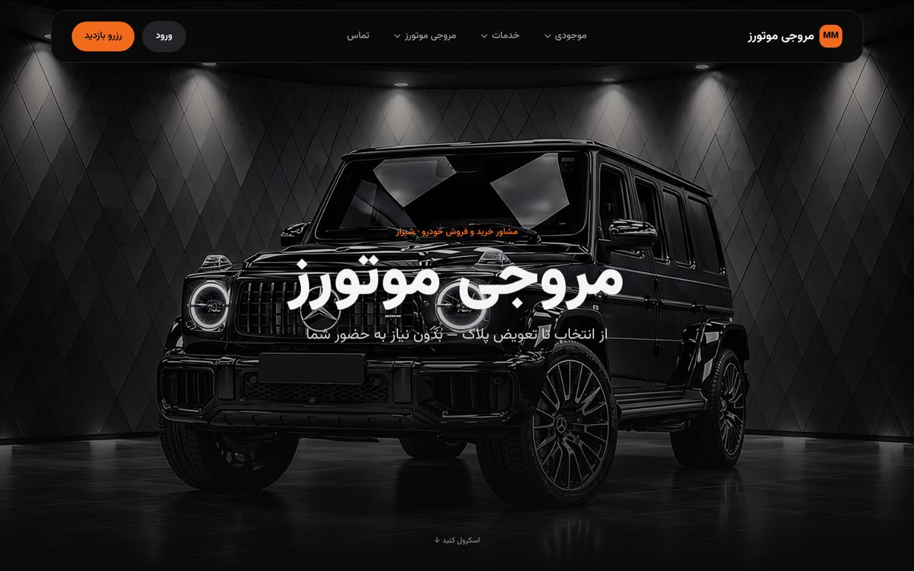 | 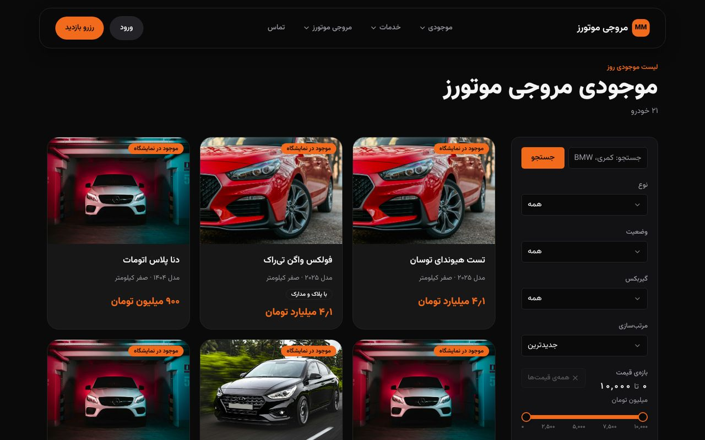 |
| **Fahrzeugseite mit Galerie & Reservierung** | **Leistungen & Preise** |
| 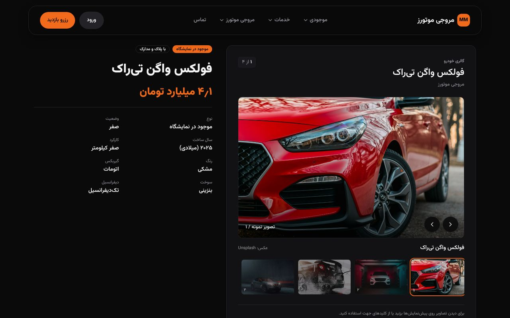 | 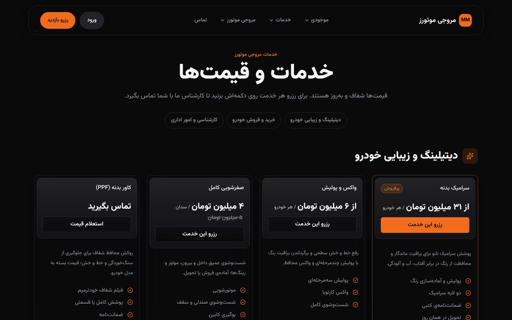 |
| **Admin-Dashboard** | **Admin: Leistungen & Preise bearbeiten** |
| 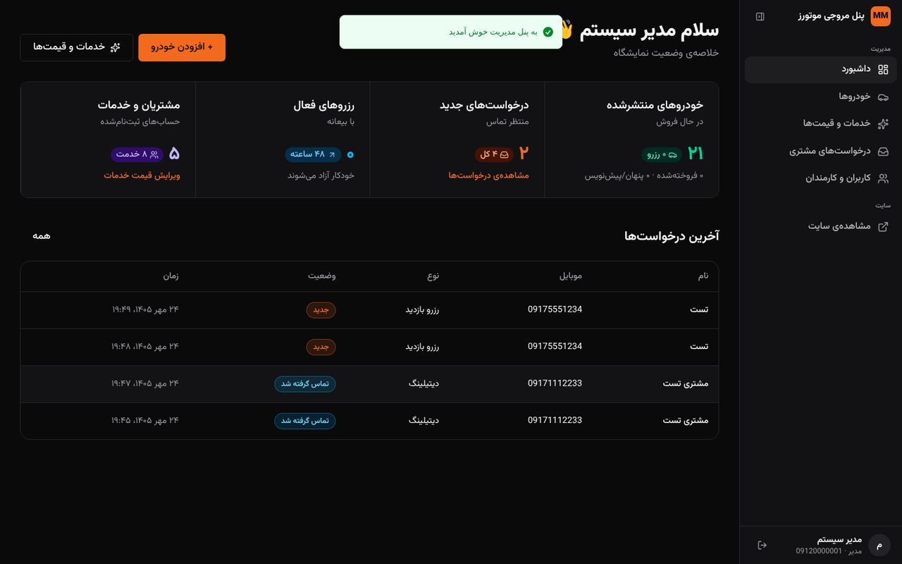 | 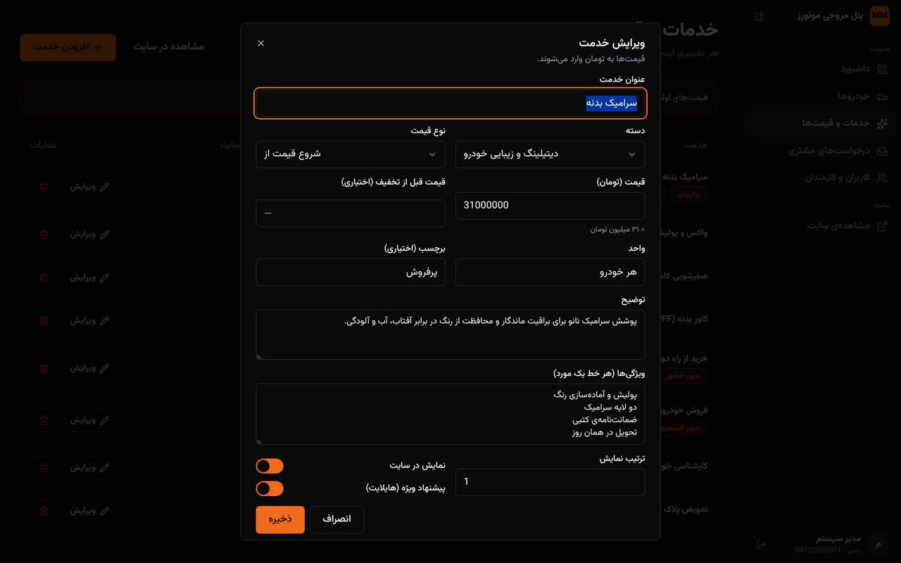 |
| **Admin: Fahrzeuge** | **Login (OTP + Demo-Zugang)** |
| 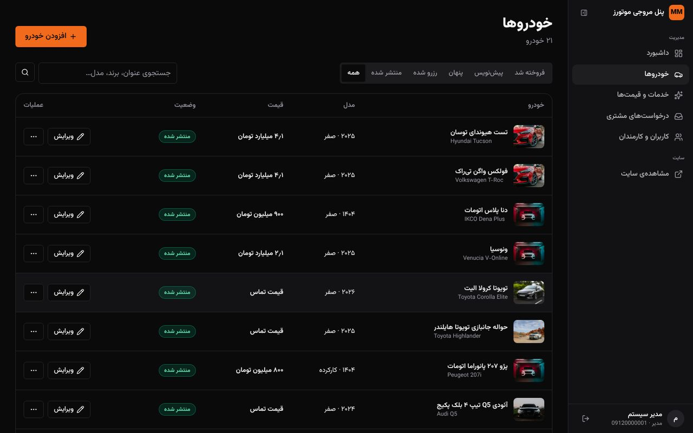 | 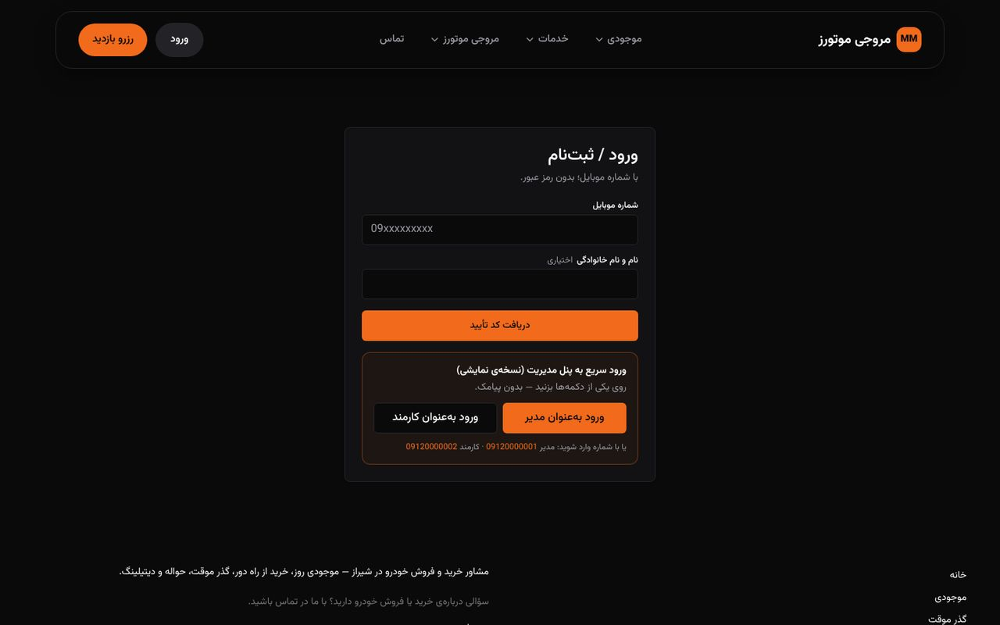 |

**Mobil** (auf Handys und langsamen Geräten wird statt des Videos ein Standbild geladen):

<p>
  
  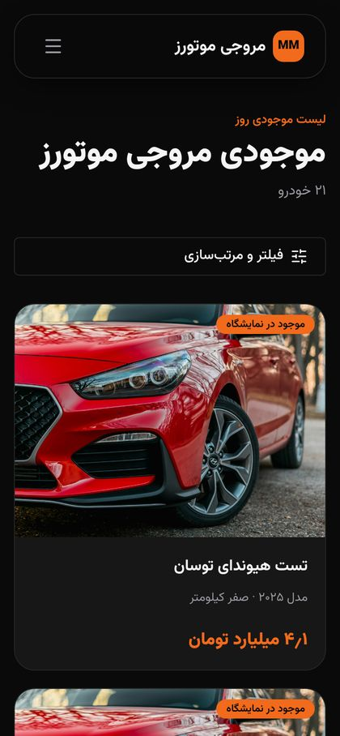
  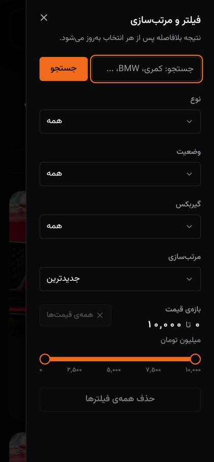
  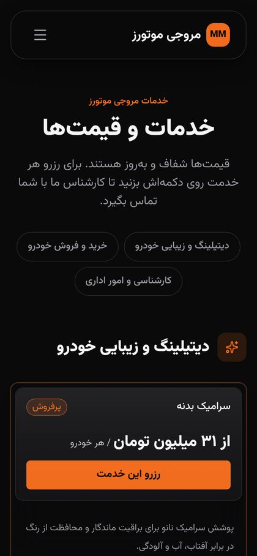
</p>

## 🧩 Technologien

| Bereich | Technologie | Wofür |
|---|---|---|
| Backend | **ASP.NET Core 9**, C# 13 | REST-API (`/api/v1`), Controller, ProblemDetails |
| Architektur | **Clean Architecture** (Domain · Application · Infrastructure · Api) | Geschäftsregeln unabhängig von Framework und Datenbank |
| Daten | **EF Core 9**, SQLite (Dev/Demo), SQL Server (Prod) | Optimistic Concurrency, gefilterte Unique-Indizes, Soft Delete, Audit-Log |
| Auth | ASP.NET Identity, **JWT** + HttpOnly-Refresh-Cookie, **SMS-OTP** (Kavenegar) | passwortloser Login, Rollen Admin/Mitarbeiter/Benutzer |
| Validierung | **FluentValidation** | jede Eingabe, Fehler als `422` |
| Performance | **HybridCache** (Tag-Invalidierung), Response Compression | schneller Bestand, sofort aktuelle Preise |
| Schutz | Rate Limiting, CORS, Security-Header, ForwardedHeaders | OTP-Brute-Force, Missbrauch, echte Client-IP hinter Proxy |
| Hintergrund | Hosted Service | abgelaufene Reservierungen jede Minute freigeben |
| Frontend | **Next.js 15** (App Router, Standalone-Build), **React 19**, **TypeScript** | SSR/SEO, Admin- und Benutzerbereich |
| UI | **Tailwind CSS v4**, Komponenten von **21st.dev**, Vazirmatn, RTL | moderne persische Oberfläche |
| Medien | **ffmpeg** (Scroll-Scrub-Encodes, Standbilder) | flüssiges Hero-Video, leicht für langsame Netze |
| Tests | **xUnit**, `WebApplicationFactory`, **Playwright** (E2E) | 37 Domain- + 27 API-Tests, Browser-Szenarien |
| Betrieb | **Docker** (ein Container: API + Website), **Render**, GitHub Actions | Live-Demo, CI |

## 🏗️ Architektur

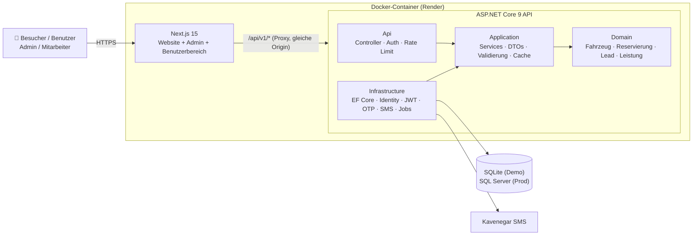

**Sichere Reservierung – ein Fahrzeug kann nie doppelt verkauft werden:**

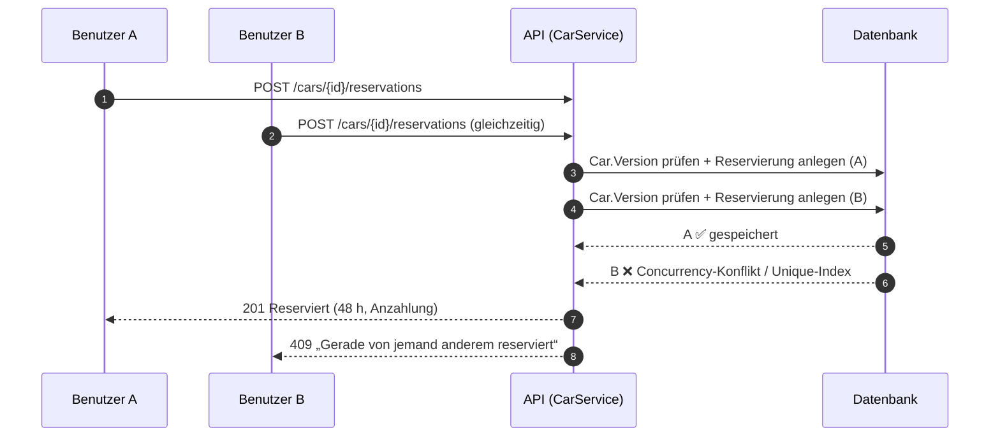

**Login ohne Passwort:**

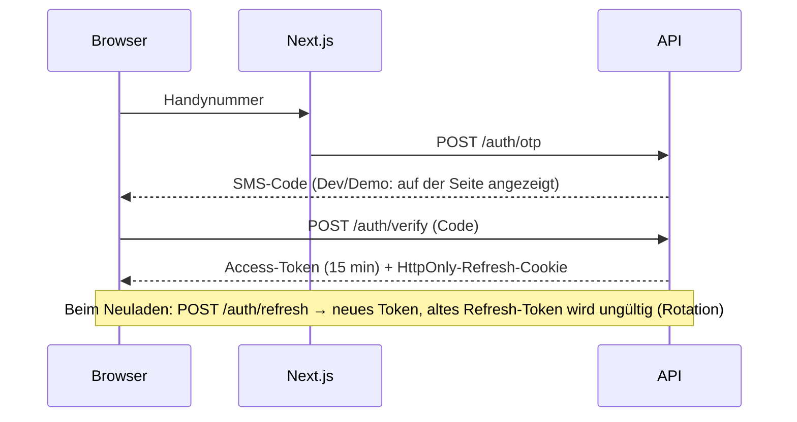

## Projektstruktur

```
MoravejiMotors.sln
├── src/
│   ├── Moraveji.Domain          ← Geschäftsregeln (Fahrzeug, Reservierung, Auftrag, Lead, Leistung) – ohne Abhängigkeiten
│   ├── Moraveji.Application     ← Services, DTOs, Validierung (FluentValidation), Caching
│   ├── Moraveji.Infrastructure  ← EF Core, Identity, OTP, JWT, SMS, Seed-Daten, Hintergrundjobs
│   └── Moraveji.Api             ← Controller, Sicherheit, Rate Limiting, Swagger
├── tests/
│   ├── Moraveji.UnitTests        ← 37 Domain-Tests
│   └── Moraveji.IntegrationTests ← 27 API-Tests gegen eine echte Datenbank (parallele Reservierungen, OTP-Brute-Force, Rechte …)
├── web/                          ← Next.js-Frontend
├── docs/                         ← 21st.dev-Komponenten, Screenshots
└── docker-compose.yml
```

## Starten mit Visual Studio (einfachster Weg) ✅

1. `MoravejiMotors.sln` in Visual Studio öffnen.
2. Oben das Startprofil **„CarShop (سایت + API)“** wählen und **F5** drücken.

Visual Studio erledigt dann alles automatisch:
- startet die API auf `http://localhost:5080`,
- führt bei Bedarf `npm install` für die Website aus (beim ersten Mal einige Minuten),
- startet die Next.js-Website auf `http://localhost:3000` und öffnet sie im Browser,
- beendet beim **Stop** beides wieder.

Voraussetzungen: **.NET 9 SDK** und **Node.js LTS** (`setup.bat` installiert beides einmalig).
Das Profil „فقط API (Swagger)“ startet nur die API mit Swagger.

## Anmeldung in den Bereichen

Die Anmeldung erfolgt passwortlos per **SMS-Code (OTP)**. In der Entwicklung wird keine echte SMS gesendet: Der 6-stellige Code wird **direkt auf der Login-Seite angezeigt** („ورود با این کد“) und zusätzlich in der API-Konsole ausgegeben (`DEV OTP for …`).

| Bereich | Adresse | Testnummer |
|---|---|---|
| **Admin-Bereich** | http://localhost:3000/admin | `09120000001` |
| **Mitarbeiter-Bereich** (eingeschränkt: keine Preise/Benutzer ändern) | http://localhost:3000/admin | `09120000002`, `09120000003` |
| **Benutzerbereich** | http://localhost:3000/account | jede andere Handynummer – erste Anmeldung = Registrierung |

Auf der Login-Seite gibt es in der Entwicklung Schnellwahl-Buttons für die Testkonten.

**Admin-Bereich:** Dashboard mit Kennzahlen · Fahrzeuge (anlegen, Preis ändern, veröffentlichen/verbergen/als verkauft markieren, löschen) · Leistungen & Preise (anlegen, bearbeiten, Rabatt, ein-/ausblenden, löschen – sofort auf `/services` sichtbar) · Anfragen (Status ändern, Anruf/WhatsApp) · Benutzer & Mitarbeiter (Mitarbeiter per Nummer hinzufügen, Rollen ändern).

**Benutzerbereich:** meine Reservierungen (mit Stornierung), meine Anfragen, Profil bearbeiten.

## Manuell starten (ohne Visual Studio)

```powershell
cd C:\xampp\htdocs\galeri
dotnet test                                                    # alle 64 Tests müssen grün sein
dotnet run --project src\Moraveji.Api --urls http://localhost:5080

# zweites Fenster
cd C:\xampp\htdocs\galeri\web
copy .env.example .env.local
npm install
npm run dev
```

Website: http://localhost:3000 – bitte über `localhost` öffnen (nicht 127.0.0.1), damit das Login-Cookie funktioniert.
Swagger: http://localhost:5080/swagger

In der Entwicklung wird die SQLite-Datenbank (`moraveji-dev.db`) automatisch erstellt und mit 20 Demo-Fahrzeugen und 8 Demo-Leistungen befüllt.

**Offline-Präsentation** (falls Unsplash/Pexels langsam oder gesperrt sind):

```powershell
cd web
npm run fetch-media          # Bilder/Video lokal speichern
# in web\.env.local:  NEXT_PUBLIC_LOCAL_MEDIA=1
```

## Seiten

`/` Startseite (Scroll-Video-Hero, Fernkauf, aktueller Bestand, Leistungen, Firmenkooperationen, Bewertungen) · `/inventory` (Filter & Suche) · `/cars/{slug}` (Galerie, Daten, Reservierung mit Anzahlung) · `/services` (Leistungen & Preise) · `/contact?type=…` · `/login` · `/account` · `/admin`

## Wichtigste API-Endpunkte

| Methode | Pfad | Zugriff |
|---|---|---|
| POST | `/api/v1/auth/otp`, `/auth/verify`, `/auth/refresh`, `/auth/logout` | öffentlich |
| GET | `/api/v1/cars`, `/api/v1/cars/{slug}` | öffentlich |
| POST | `/api/v1/cars/{id}/reservations` | angemeldeter Benutzer – `409`, wenn jemand schneller war |
| GET | `/api/v1/services` | öffentlich (Preisliste) |
| POST | `/api/v1/leads` | öffentlich (Preisanfrage, Besichtigung, Fernkauf …) |
| GET / PATCH | `/api/v1/leads`, `/leads/{id}/status` | Mitarbeiter (eigene + unzugewiesene) / Admin (alle) |
| GET / POST / PUT / DELETE | `/api/v1/admin/services` | Lesen: Mitarbeiter & Admin – Ändern: nur Admin |
| GET / POST / PUT / DELETE | `/api/v1/admin/cars`, `/{id}`, `/{id}/status` | Mitarbeiter/Admin (Status & Löschen: nur Admin) |
| GET | `/api/v1/admin/stats` | Mitarbeiter & Admin |
| GET / POST / PUT | `/api/v1/admin/users`, `/{id}/role` | nur Admin |
| GET / PUT / POST | `/api/v1/me`, `/me/reservations`, `/me/reservations/{id}/cancel`, `/me/leads` | angemeldeter Benutzer (nur eigene Daten) |
| GET | `/health/live`, `/health/ready` | Monitoring |

## Sicherheit & Geld – Garantien

- **Ein Fahrzeug wird nie doppelt reserviert/verkauft:** Concurrency-Token (`Version`) pro Datensatz + **gefilterter Unique-Index** `UX_Reservations_OneActivePerCar` direkt in der Datenbank. Test: 6 gleichzeitige Benutzer → genau 1 Erfolg, alle anderen `409`.
- **Pro Benutzer nur eine aktive Reservierung** (`UX_Reservations_OneActivePerCustomer`) + Rate Limiting – ein Konto kann nicht den ganzen Bestand blockieren.
- **Optimistic Locking im Admin:** Ein veraltetes Bearbeitungsformular erhält `409`, statt Änderungen anderer zu überschreiben.
- **Login:** Access-Token 15 Minuten; Refresh-Token als `HttpOnly; Secure; SameSite=Strict`-Cookie mit **Rotation** – Wiederverwendung eines alten Tokens beendet die ganze Sitzung (Diebstahlerkennung).
- **OTP** wird nur als HMAC gespeichert; Fehlversuche und Token-Rotation sind **atomar** (parallele Anfragen können Limits nicht umgehen).
- **Rollen & Ressourcen:** Admin / Mitarbeiter / Benutzer; Benutzer sehen nur eigene Daten (Schutz vor IDOR), IDs sind `Guid`s.
- Geldbeträge immer als `long` in **Rial** (Anzeige in Toman).
- **Unveränderliches Audit-Log** für Fahrzeuge, Reservierungen, Leads und Leistungen; Soft Delete statt Löschen.
- Abgelaufene Reservierungen werden jede Minute automatisch freigegeben.
- Rate Limiting für OTP, Login, Token-Refresh und Formulare; strikte CORS-Whitelist; Security-Header; Fehler als ProblemDetails ohne Stacktrace.
- Der Entwicklungs-OTP auf der Login-Seite wird **nur in der Development-Umgebung** ausgeliefert (per Test abgesichert).

## Konfiguration für Produktion (nur Umgebungsvariablen – keine Secrets im Code)

```
ASPNETCORE_ENVIRONMENT=Production
Database__Provider=SqlServer
ConnectionStrings__Default=Server=...;Database=MoravejiMotors;...
Jwt__SigningKey=<mind. 32 zufällige Zeichen>
Otp__HashKey=<mind. 32 zufällige Zeichen>
Sms__Provider=Kavenegar
Sms__ApiKey=<Kavenegar-Schlüssel>
Sms__OtpTemplate=moraveji-otp
Seed__AdminPhone=09...
```

Ohne `Jwt__SigningKey` bzw. `Otp__HashKey` startet die Anwendung in Produktion absichtlich nicht. Siehe auch `.env.example`.

## Ideen für später

- [x] Phase 1: Drei-Schichten-Grundgerüst, OTP-Login, Rollen
- [x] Phase 2: Fahrzeugkatalog, sichere Reservierung, Leads, Seed-Daten
- [x] Phase 3: Next.js-Frontend ausschließlich mit 21st.dev-Komponenten
- [x] Admin-Bereich (Dashboard, Fahrzeuge, Leistungen & Preise, Anfragen, Benutzer), Benutzerbereich, Leistungsseite, Start per F5 in Visual Studio
- [ ] Online-Zahlung (Ledger + Outbox), Foto-Upload im Admin
- [ ] Shop, Online-Vertrag, Mitarbeiter-CRM, Reporting

## Credits

Alle verwendeten 21st.dev-Komponenten sind in `docs/21st-components.md` aufgeführt, die Quellen der Demo-Fotos und des Videos in `CREDITS.md`.
